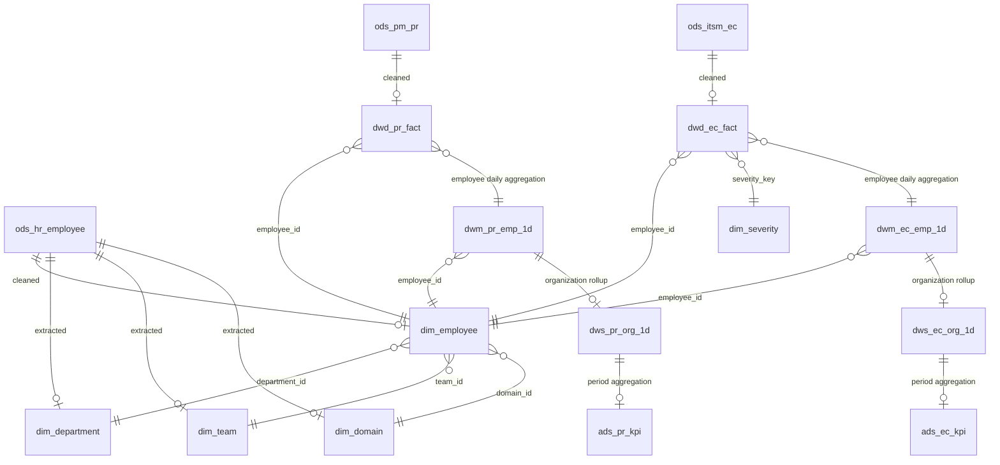

# Data Warehouse Database Design Document (All Layers)

This document describes the complete layered design of the employee KPI warehouse, covering two business areas: **PR (project requirements)** and **EC (incidents)**. The metric system is aligned with `EMPLOYEE_DIRECTORY_KPI_MAP.md`.

## 1. Layered architecture

| Layer | Description | Table prefix | Purpose |
|---|---|---|---|
| ODS source layer | Preserves raw data from business systems | `ods_` | Raw ingestion, deduplication staging |
| DWD detail layer | Cleaned, standardized fact details joined to dimensions | `dwd_` | Unified metric definitions, derived calculation fields |
| DIM dimension layer | Conformed dimensions | `dim_` | Descriptive attributes |
| DWM intermediate layer | Subject-level light aggregation (for common reuse) | `dwm_` | Atomic employee x day summaries |
| DWS summary layer | Business summaries pre-aggregated by organization and grain | `dws_` | Accelerates computation across multiple levels |
| ADS application layer | KPI result tables for reporting | `ads_` | Consumed directly by reports |

Data flow:

```text
Business systems → ODS → DWD → DWM → DWS → ADS
                  ↘ DIM ↗
```

## 2. Naming and general conventions

- Table names: `<layer prefix>_<subject>_<object/grain>`
- Columns: lowercase with underscores
- Amounts: `decimal(12,2)`, scores: `decimal(4,2)`, ratios: `decimal(8,4)` (stored as decimals)
- All tables use `utf8mb4`
- All ODS tables include ETL metadata columns
- Fact tables join dimensions using surrogate keys (`*_key`) and retain business keys (`*_id`) for traceability

**Common ODS ETL metadata columns**: `etl_load_time`, `etl_source`, `etl_batch_id`, `etl_operation`, `data_date`

---

## 3. ODS source layer

### 3.1 ods_hr_employee (employee master data)

| Column | Type | Description |
|---|---|---|
| employee_id | bigint | Employee ID (business primary key) |
| employee_name | varchar(80) | Name |
| department_id | bigint | Department ID |
| department_name | varchar(80) | Department name |
| team_id | bigint | Team ID |
| team_name | varchar(80) | Team name |
| domain_id | bigint | Domain ID |
| domain_name | varchar(80) | Domain name |
| position | varchar(80) | Position |
| job_level | varchar(32) | Job level |
| employment_status | varchar(16) | Employment status |
| join_date | date | Hire date |
| manager_id | bigint | Direct manager ID |
| + ETL metadata columns | | |

### 3.2 ods_pm_pr (PR project requirements)

| Column | Type | Description |
|---|---|---|
| pr_id | bigint | Requirement ID (business primary key) |
| pr_name | varchar(128) | Requirement name |
| employee_id | bigint | Owner |
| project_id | bigint | Project ID |
| assign_date | date | Assigned date |
| due_date | date | Planned delivery date |
| complete_date | date | Actual completion date |
| status | varchar(16) | Status |
| rework_flag | tinyint | Rework flag |
| work_hours | decimal(8,2) | Work hours |
| + ETL metadata columns | | |

### 3.3 ods_itsm_ec (EC incidents)

| Column | Type | Description |
|---|---|---|
| ec_id | bigint | Incident ID (business primary key) |
| ec_title | varchar(128) | Incident title |
| employee_id | bigint | Handler |
| project_id | bigint | Related project ID |
| severity | varchar(8) | Severity (P0/P1/P2/P3) |
| found_at | datetime | Found at |
| first_response_at | datetime | First response time |
| resolved_at | datetime | Resolved at |
| status | varchar(16) | Status |
| recur_flag | tinyint | Recurrence flag |
| + ETL metadata columns | | |

---

## 4. DWD detail layer

Responsibilities of the DWD layer: clean dirty data, standardize enums, join dimension surrogate keys, and derive calculation fields (duration, on-time flag, severe flag).

### 4.1 dwd_pr_fact (PR requirement detail fact)

Source: `ods_pm_pr`

| Column | Type | Description |
|---|---|---|
| pr_key | bigint | Surrogate key (primary key) |
| pr_id | bigint | Business key |
| employee_id | bigint | Joins dim_employee |
| assign_date_key | int | Assigned date key (dim_date) |
| due_date_key | int | Planned delivery date key |
| complete_date_key | int | Completion date key |
| project_id | bigint | Project ID |
| status_code | varchar(16) | Standardized status |
| rework_flag | tinyint | Rework flag |
| is_on_time | tinyint | On-time delivery flag (1/0) |
| process_days | int | Processing time (completion - assigned, days) |
| work_hours | decimal(8,2) | Work hours |

### 4.2 dwd_ec_fact (EC incident detail fact)

Source: `ods_itsm_ec`

| Column | Type | Description |
|---|---|---|
| ec_key | bigint | Surrogate key (primary key) |
| ec_id | bigint | Business key |
| employee_id | bigint | Joins dim_employee |
| project_id | bigint | Joins dim_project |
| severity_key | tinyint | Joins dim_severity |
| found_date_key | int | Found date key |
| resolved_date_key | int | Resolved date key |
| status_code | varchar(16) | Standardized status |
| recur_flag | tinyint | Recurrence flag |
| is_severe | tinyint | Severe incident flag (P0/P1=1) |
| response_minutes | int | First response time (min) |
| resolve_minutes | int | Resolution time (min) |

---

## 5. DIM dimension layer

### 5.1 dim_employee (employee dimension)

| Column | Type | Description |
|---|---|---|
| employee_id | bigint | Employee ID (primary key, unique identifier) |
| employee_name | varchar(80) | Name |
| department_id | bigint | Department business key |
| team_id | bigint | Team business key |
| domain_id | bigint | Domain business key |
| position_name | varchar(80) | Position name |
| job_level | varchar(32) | Job level |
| employment_status | varchar(16) | Employment status |
| join_date | date | Hire date |
| manager_id | bigint | Direct manager ID |

### 5.2 dim_department (department dimension)

| Column | Type | Description |
|---|---|---|
| department_key | bigint | Surrogate key (primary key) |
| department_id | bigint | Business key |
| department_name | varchar(80) | Department name |
| parent_department_id | bigint | Parent department |
| is_current | tinyint | Current-version flag |
| effective_date | date | Effective date |
| expire_date | date | Expiry date |

### 5.3 dim_team (team dimension)

| Column | Type | Description |
|---|---|---|
| team_key | bigint | Surrogate key (primary key) |
| team_id | bigint | Business key |
| team_name | varchar(80) | Team name |
| department_id | bigint | Department |
| is_current | tinyint | Current-version flag |
| effective_date | date | Effective date |
| expire_date | date | Expiry date |

### 5.4 dim_domain (domain dimension)

| Column | Type | Description |
|---|---|---|
| domain_key | bigint | Surrogate key (primary key) |
| domain_id | bigint | Business key |
| domain_name | varchar(80) | Domain name |
| is_current | tinyint | Current-version flag |
| effective_date | date | Effective date |
| expire_date | date | Expiry date |

### 5.5 dim_date (date dimension)

| Column | Type | Description |
|---|---|---|
| date_key | int | Date surrogate key (yyyymmdd) |
| full_date | date | Date |
| year | smallint | Year |
| quarter | tinyint | Quarter |
| month | tinyint | Month |
| week_of_year | tinyint | Week of year |
| day_of_week | tinyint | Day of week |
| is_weekend | tinyint | Weekend flag |
| is_holiday | tinyint | Holiday flag |

### 5.6 dim_severity (incident severity dimension)

| Column | Type | Description |
|---|---|---|
| severity_key | tinyint | Surrogate key (primary key) |
| severity_code | varchar(8) | Severity code |
| severity_name | varchar(32) | Severity name |
| priority_order | tinyint | Sort weight |

---

## 6. DWM intermediate layer

The DWM layer builds on DWD detail facts and performs subject-level light aggregation by **employee x date**, retaining metric numerators and denominators for reuse by the DWS layer across multiple organizations and periods.

### 6.1 dwm_pr_emp_1d (PR employee daily summary)

| Column | Type | Description |
|---|---|---|
| stat_date | date | Statistic date |
| employee_id | bigint | Employee ID |
| pr_assign_cnt | int | Requirements Assigned |
| pr_complete_cnt | int | Requirements Completed |
| pr_due_cnt | int | Requirements Due |
| pr_on_time_cnt | int | On-time Deliveries |
| pr_rework_cnt | int | Reworked Requirements |
| pr_process_days_sum | int | Total Processing Time (days) |
| pr_work_hours_sum | decimal(12,2) | Total Work Hours |
| Primary key | | (stat_date, employee_id) |

### 6.2 dwm_ec_emp_1d (EC employee daily summary)

| Column | Type | Description |
|---|---|---|
| stat_date | date | Statistic date |
| employee_id | bigint | Employee ID |
| ec_found_cnt | int | Incidents Found |
| ec_resolved_cnt | int | Incidents Resolved |
| ec_recur_cnt | int | Recurring Incidents |
| ec_severe_cnt | int | Severe Incidents |
| ec_response_minutes_sum | int | Total Response Time (min) |
| ec_resolve_minutes_sum | int | Total Resolution Time (min) |
| Primary key | | (stat_date, employee_id) |

---

## 6A. DWS summary layer

The DWS layer rolls up from DWM and aggregates by **organization x date**. `org_type` supports four levels: employee / team / domain / department.

### 6A.1 dws_pr_org_1d (PR organization daily summary)

| Column | Type | Description |
|---|---|---|
| stat_date | date | Statistic date |
| org_type | varchar(16) | Organization type |
| org_id | bigint | Organization business key |
| pr_assign_cnt | int | Requirements Assigned |
| pr_complete_cnt | int | Requirements Completed |
| pr_due_cnt | int | Requirements Due |
| pr_on_time_cnt | int | On-time Deliveries |
| pr_rework_cnt | int | Reworked Requirements |
| pr_process_days_sum | int | Total Processing Time (days) |
| pr_work_hours_sum | decimal(12,2) | Total Work Hours |
| Primary key | | (stat_date, org_type, org_id) |

### 6A.2 dws_ec_org_1d (EC organization daily summary)

| Column | Type | Description |
|---|---|---|
| stat_date | date | Statistic date |
| org_type | varchar(16) | Organization type |
| org_id | bigint | Organization business key |
| ec_found_cnt | int | Incidents Found |
| ec_resolved_cnt | int | Incidents Resolved |
| ec_recur_cnt | int | Recurring Incidents |
| ec_severe_cnt | int | Severe Incidents |
| ec_response_minutes_sum | int | Total Response Time (min) |
| ec_resolve_minutes_sum | int | Total Resolution Time (min) |
| Primary key | | (stat_date, org_type, org_id) |

---

## 7. ADS application layer

The ADS layer is report-oriented and outputs final KPIs by **organization x period**, sourced from period aggregation of DWS organization daily summaries. `org_type` supports employee / team / domain / department; `period_type` supports week / month / quarter / halfyear / year.

### 7.1 ads_pr_kpi (PR project requirement KPIs)

| Column | Type | Description |
|---|---|---|
| period_type | varchar(16) | Period type |
| period_value | varchar(32) | Period value (e.g. 2026-11, 2026-W46) |
| org_type | varchar(16) | Organization type |
| org_id | bigint | Organization business key |
| pr_assign_cnt | int | Requirements Assigned |
| pr_complete_cnt | int | Requirements Completed |
| pr_due_cnt | int | Requirements Due |
| pr_on_time_cnt | int | On-time Deliveries |
| pr_process_days_sum | int | Total Processing Time (days) |
| pr_rework_cnt | int | Reworked Requirements |
| pr_completion_rate | decimal(8,4) | Requirement Completion Rate |
| pr_on_time_rate | decimal(8,4) | On-time Delivery Rate |
| pr_avg_process_days | decimal(8,2) | Avg. Processing Time (days) |
| pr_rework_rate | decimal(8,4) | Rework Rate |
| pr_work_hours_ratio | decimal(8,4) | Requirement Work-Hours Ratio |
| Primary key | | (period_type, period_value, org_type, org_id) |

### 7.2 ads_ec_kpi (EC incident KPIs)

| Column | Type | Description |
|---|---|---|
| period_type | varchar(16) | Period type |
| period_value | varchar(32) | Period value |
| org_type | varchar(16) | Organization type |
| org_id | bigint | Organization business key |
| ec_found_cnt | int | Incidents Found |
| ec_resolved_cnt | int | Incidents Resolved |
| ec_response_minutes_sum | int | Total Response Time (min) |
| ec_resolve_minutes_sum | int | Total Resolution Time (min) |
| ec_recur_cnt | int | Recurring Incidents |
| ec_resolution_rate | decimal(8,4) | Incident Resolution Rate |
| ec_avg_response_minutes | decimal(8,2) | Avg. Response Time (min) |
| ec_avg_resolve_minutes | decimal(8,2) | Avg. Resolution Time (min) |
| ec_recur_rate | decimal(8,4) | Incident Recurrence Rate |
| ec_severe_cnt | int | Severe Incidents |
| Primary key | | (period_type, period_value, org_type, org_id) |

---

## 8. Mapping of KPIs to layered fields

### PR (project requirements)

| KPI | Metric definition | Source layer and field |
|---|---|---|
| Requirements Assigned | COUNT / SUM | dwm_pr_emp_1d.pr_assign_cnt |
| Requirements Completed | COUNT / SUM | dwm_pr_emp_1d.pr_complete_cnt |
| Requirement Completion Rate | Completed / Assigned | ads_pr_kpi.pr_completion_rate |
| On-time Delivery Rate | On-time / Requirements Due | ads_pr_kpi.pr_on_time_rate |
| Avg. Processing Time | Total Processing Time / Completed | ads_pr_kpi.pr_avg_process_days |
| Rework Rate | Reworked / Delivered | ads_pr_kpi.pr_rework_rate |
| Requirement Work-Hours Ratio | Requirement work hours / Effective work hours | ads_pr_kpi.pr_work_hours_ratio |

### EC (incidents)

| KPI | Metric definition | Source layer and field |
|---|---|---|
| Incidents Found | COUNT / SUM | dwm_ec_emp_1d.ec_found_cnt |
| Incidents Resolved | COUNT / SUM | dwm_ec_emp_1d.ec_resolved_cnt |
| Incident Resolution Rate | Resolved / Found | ads_ec_kpi.ec_resolution_rate |
| Avg. Response Time | Total Response Time / Incidents | ads_ec_kpi.ec_avg_response_minutes |
| Avg. Resolution Time | Total Resolution Time / Resolved | ads_ec_kpi.ec_avg_resolve_minutes |
| Incident Recurrence Rate | Recurring / Resolved | ads_ec_kpi.ec_recur_rate |
| Severe Incidents | COUNT | ads_ec_kpi.ec_severe_cnt |

> The "effective work hours" in the requirement work-hours ratio requires integration with an attendance/work-hours system; without it, `pr_work_hours_ratio` is left null.

---

## 9. Table relationships



---

## 10. Table-creation SQL (MySQL 5.7, utf8mb4)

### 10.1 ODS layer

```sql
CREATE DATABASE IF NOT EXISTS analytics_dw
  CHARACTER SET utf8mb4 COLLATE utf8mb4_unicode_ci;
USE analytics_dw;

CREATE TABLE ods_hr_employee (
  employee_id       BIGINT       NOT NULL,
  employee_name     VARCHAR(80)  NOT NULL,
  department_id     BIGINT       NULL,
  department_name   VARCHAR(80)  NULL,
  team_id           BIGINT       NULL,
  team_name         VARCHAR(80)  NULL,
  domain_id         BIGINT       NULL,
  domain_name       VARCHAR(80)  NULL,
  position          VARCHAR(80)  NULL,
  job_level         VARCHAR(32)  NULL,
  employment_status VARCHAR(16)  NULL,
  join_date         DATE         NULL,
  manager_id        BIGINT       NULL,
  etl_load_time     DATETIME     NOT NULL,
  etl_source        VARCHAR(32)  NOT NULL,
  etl_batch_id      VARCHAR(64)  NULL,
  etl_operation     CHAR(1)      NOT NULL,
  data_date         DATE         NOT NULL,
  PRIMARY KEY (employee_id, data_date),
  KEY idx_data_date (data_date),
  KEY idx_department (department_id),
  KEY idx_team (team_id),
  KEY idx_domain (domain_id)
) ENGINE=InnoDB DEFAULT CHARSET=utf8mb4 COMMENT='employee master data (ODS)';

CREATE TABLE ods_pm_pr (
  pr_id          BIGINT        NOT NULL,
  pr_name        VARCHAR(128)  NULL,
  employee_id    BIGINT        NULL,
  project_id     BIGINT        NULL,
  assign_date    DATE          NULL,
  due_date       DATE          NULL,
  complete_date  DATE          NULL,
  status         VARCHAR(16)   NULL,
  rework_flag    TINYINT       NULL,
  work_hours     DECIMAL(8,2)  NULL,
  etl_load_time  DATETIME      NOT NULL,
  etl_source     VARCHAR(32)   NOT NULL,
  etl_batch_id   VARCHAR(64)   NULL,
  etl_operation  CHAR(1)       NOT NULL,
  data_date      DATE          NOT NULL,
  PRIMARY KEY (pr_id, data_date),
  KEY idx_data_date (data_date),
  KEY idx_employee (employee_id),
  KEY idx_assign_date (assign_date)
) ENGINE=InnoDB DEFAULT CHARSET=utf8mb4 COMMENT='PR project requirements (ODS)';

CREATE TABLE ods_itsm_ec (
  ec_id             BIGINT        NOT NULL,
  ec_title          VARCHAR(128)  NULL,
  employee_id       BIGINT        NULL,
  project_id        BIGINT        NULL,
  severity          VARCHAR(8)    NULL,
  found_at          DATETIME      NULL,
  first_response_at DATETIME      NULL,
  resolved_at       DATETIME      NULL,
  status            VARCHAR(16)   NULL,
  recur_flag        TINYINT       NULL,
  etl_load_time     DATETIME      NOT NULL,
  etl_source        VARCHAR(32)   NOT NULL,
  etl_batch_id      VARCHAR(64)   NULL,
  etl_operation     CHAR(1)       NOT NULL,
  data_date         DATE          NOT NULL,
  PRIMARY KEY (ec_id, data_date),
  KEY idx_data_date (data_date),
  KEY idx_employee (employee_id),
  KEY idx_project (project_id),
  KEY idx_severity (severity)
) ENGINE=InnoDB DEFAULT CHARSET=utf8mb4 COMMENT='EC incidents (ODS)';
```

### 10.2 DWD layer

```sql
CREATE TABLE dwd_pr_fact (
  pr_key          BIGINT        NOT NULL AUTO_INCREMENT,
  pr_id           BIGINT        NOT NULL,
  employee_id     BIGINT        NULL,
  assign_date_key INT           NULL,
  due_date_key    INT           NULL,
  complete_date_key INT         NULL,
  project_id      BIGINT        NULL,
  status_code     VARCHAR(16)   NULL,
  rework_flag     TINYINT       NULL,
  is_on_time      TINYINT       NULL,
  process_days    INT           NULL,
  work_hours      DECIMAL(8,2)  NULL,
  PRIMARY KEY (pr_key),
  KEY idx_pr_id (pr_id),
  KEY idx_employee (employee_id),
  KEY idx_assign_date (assign_date_key)
) ENGINE=InnoDB DEFAULT CHARSET=utf8mb4 COMMENT='PR requirement detail fact (DWD)';

CREATE TABLE dwd_ec_fact (
  ec_key            BIGINT      NOT NULL AUTO_INCREMENT,
  ec_id             BIGINT      NOT NULL,
  employee_id       BIGINT      NULL,
  project_id        BIGINT      NULL,
  severity_key      TINYINT     NULL,
  found_date_key    INT         NULL,
  resolved_date_key INT         NULL,
  status_code       VARCHAR(16) NULL,
  recur_flag        TINYINT     NULL,
  is_severe         TINYINT     NULL,
  response_minutes  INT         NULL,
  resolve_minutes   INT         NULL,
  PRIMARY KEY (ec_key),
  KEY idx_ec_id (ec_id),
  KEY idx_employee (employee_id),
  KEY idx_project (project_id),
  KEY idx_severity (severity_key)
) ENGINE=InnoDB DEFAULT CHARSET=utf8mb4 COMMENT='EC incident detail fact (DWD)';
```

### 10.3 DIM layer

```sql
CREATE TABLE dim_employee (
  employee_id       BIGINT       NOT NULL,
  employee_name     VARCHAR(80)  NOT NULL,
  department_id     BIGINT       NULL,
  team_id           BIGINT       NULL,
  domain_id         BIGINT       NULL,
  position_name     VARCHAR(80)  NULL,
  job_level         VARCHAR(32)  NULL,
  employment_status VARCHAR(16)  NULL,
  join_date         DATE         NULL,
  manager_id        BIGINT       NULL,
  PRIMARY KEY (employee_id)
) ENGINE=InnoDB DEFAULT CHARSET=utf8mb4 COMMENT='employee dimension (daily full snapshot)';

CREATE TABLE dim_department (
  department_key       BIGINT      NOT NULL AUTO_INCREMENT,
  department_id        BIGINT      NOT NULL,
  department_name      VARCHAR(80) NOT NULL,
  parent_department_id BIGINT      NULL,
  is_current           TINYINT     NOT NULL DEFAULT 1,
  effective_date       DATE        NOT NULL,
  expire_date          DATE        NOT NULL DEFAULT '9999-12-31',
  PRIMARY KEY (department_key),
  KEY idx_department_id (department_id)
) ENGINE=InnoDB DEFAULT CHARSET=utf8mb4 COMMENT='department dimension';

CREATE TABLE dim_team (
  team_key       BIGINT      NOT NULL AUTO_INCREMENT,
  team_id        BIGINT      NOT NULL,
  team_name      VARCHAR(80) NOT NULL,
  department_id  BIGINT      NULL,
  is_current     TINYINT     NOT NULL DEFAULT 1,
  effective_date DATE        NOT NULL,
  expire_date    DATE        NOT NULL DEFAULT '9999-12-31',
  PRIMARY KEY (team_key),
  KEY idx_team_id (team_id)
) ENGINE=InnoDB DEFAULT CHARSET=utf8mb4 COMMENT='team dimension';

CREATE TABLE dim_domain (
  domain_key     BIGINT      NOT NULL AUTO_INCREMENT,
  domain_id      BIGINT      NOT NULL,
  domain_name    VARCHAR(80) NOT NULL,
  is_current     TINYINT     NOT NULL DEFAULT 1,
  effective_date DATE        NOT NULL,
  expire_date    DATE        NOT NULL DEFAULT '9999-12-31',
  PRIMARY KEY (domain_key),
  KEY idx_domain_id (domain_id)
) ENGINE=InnoDB DEFAULT CHARSET=utf8mb4 COMMENT='domain dimension';

CREATE TABLE dim_date (
  date_key      INT       NOT NULL,
  full_date     DATE      NOT NULL,
  year          SMALLINT  NOT NULL,
  quarter       TINYINT   NOT NULL,
  month         TINYINT   NOT NULL,
  week_of_year  TINYINT   NOT NULL,
  day_of_week   TINYINT   NOT NULL,
  is_weekend    TINYINT   NOT NULL,
  is_holiday    TINYINT   NOT NULL,
  PRIMARY KEY (date_key)
) ENGINE=InnoDB DEFAULT CHARSET=utf8mb4 COMMENT='date dimension';

CREATE TABLE dim_severity (
  severity_key   TINYINT     NOT NULL,
  severity_code  VARCHAR(8)  NOT NULL,
  severity_name  VARCHAR(32) NOT NULL,
  priority_order TINYINT     NOT NULL,
  PRIMARY KEY (severity_key)
) ENGINE=InnoDB DEFAULT CHARSET=utf8mb4 COMMENT='incident severity dimension';
```

### 10.4 DWM layer

```sql
CREATE TABLE dwm_pr_emp_1d (
  stat_date           DATE          NOT NULL,
  employee_id         BIGINT        NOT NULL,
  pr_assign_cnt       INT           NOT NULL DEFAULT 0,
  pr_complete_cnt     INT           NOT NULL DEFAULT 0,
  pr_due_cnt          INT           NOT NULL DEFAULT 0,
  pr_on_time_cnt      INT           NOT NULL DEFAULT 0,
  pr_rework_cnt       INT           NOT NULL DEFAULT 0,
  pr_process_days_sum INT           NOT NULL DEFAULT 0,
  pr_work_hours_sum   DECIMAL(12,2) NOT NULL DEFAULT 0,
  PRIMARY KEY (stat_date, employee_id),
  KEY idx_employee (employee_id)
) ENGINE=InnoDB DEFAULT CHARSET=utf8mb4 COMMENT='PR employee daily summary (DWM)';

CREATE TABLE dwm_ec_emp_1d (
  stat_date               DATE   NOT NULL,
  employee_id             BIGINT NOT NULL,
  ec_found_cnt            INT    NOT NULL DEFAULT 0,
  ec_resolved_cnt         INT    NOT NULL DEFAULT 0,
  ec_recur_cnt            INT    NOT NULL DEFAULT 0,
  ec_severe_cnt           INT    NOT NULL DEFAULT 0,
  ec_response_minutes_sum INT    NOT NULL DEFAULT 0,
  ec_resolve_minutes_sum  INT    NOT NULL DEFAULT 0,
  PRIMARY KEY (stat_date, employee_id),
  KEY idx_employee (employee_id)
) ENGINE=InnoDB DEFAULT CHARSET=utf8mb4 COMMENT='EC employee daily summary (DWM)';
```

### 10.4A DWS layer

```sql
CREATE TABLE dws_pr_org_1d (
  stat_date           DATE          NOT NULL,
  org_type            VARCHAR(16)   NOT NULL,
  org_id              BIGINT        NOT NULL,
  pr_assign_cnt       INT           NOT NULL DEFAULT 0,
  pr_complete_cnt     INT           NOT NULL DEFAULT 0,
  pr_due_cnt          INT           NOT NULL DEFAULT 0,
  pr_on_time_cnt      INT           NOT NULL DEFAULT 0,
  pr_rework_cnt       INT           NOT NULL DEFAULT 0,
  pr_process_days_sum INT           NOT NULL DEFAULT 0,
  pr_work_hours_sum   DECIMAL(12,2) NOT NULL DEFAULT 0,
  PRIMARY KEY (stat_date, org_type, org_id),
  KEY idx_org (org_type, org_id)
) ENGINE=InnoDB DEFAULT CHARSET=utf8mb4 COMMENT='PR organization daily summary (DWS)';

CREATE TABLE dws_ec_org_1d (
  stat_date               DATE        NOT NULL,
  org_type                VARCHAR(16) NOT NULL,
  org_id                  BIGINT      NOT NULL,
  ec_found_cnt            INT         NOT NULL DEFAULT 0,
  ec_resolved_cnt         INT         NOT NULL DEFAULT 0,
  ec_recur_cnt            INT         NOT NULL DEFAULT 0,
  ec_severe_cnt           INT         NOT NULL DEFAULT 0,
  ec_response_minutes_sum INT         NOT NULL DEFAULT 0,
  ec_resolve_minutes_sum  INT         NOT NULL DEFAULT 0,
  PRIMARY KEY (stat_date, org_type, org_id),
  KEY idx_org (org_type, org_id)
) ENGINE=InnoDB DEFAULT CHARSET=utf8mb4 COMMENT='EC organization daily summary (DWS)';
```

### 10.5 ADS layer

```sql
CREATE TABLE ads_pr_kpi (
  period_type         VARCHAR(16)   NOT NULL,
  period_value        VARCHAR(32)   NOT NULL,
  org_type            VARCHAR(16)   NOT NULL,
  org_id              BIGINT        NOT NULL,
  pr_assign_cnt       INT           NOT NULL DEFAULT 0,
  pr_complete_cnt     INT           NOT NULL DEFAULT 0,
  pr_due_cnt          INT           NOT NULL DEFAULT 0,
  pr_on_time_cnt      INT           NOT NULL DEFAULT 0,
  pr_process_days_sum INT           NOT NULL DEFAULT 0,
  pr_rework_cnt       INT           NOT NULL DEFAULT 0,
  pr_completion_rate  DECIMAL(8,4)  NULL,
  pr_on_time_rate     DECIMAL(8,4)  NULL,
  pr_avg_process_days DECIMAL(8,2)  NULL,
  pr_rework_rate      DECIMAL(8,4)  NULL,
  pr_work_hours_ratio DECIMAL(8,4)  NULL,
  PRIMARY KEY (period_type, period_value, org_type, org_id),
  KEY idx_org (org_type, org_id)
) ENGINE=InnoDB DEFAULT CHARSET=utf8mb4 COMMENT='PR project requirement KPIs (ADS)';

CREATE TABLE ads_ec_kpi (
  period_type             VARCHAR(16)   NOT NULL,
  period_value            VARCHAR(32)   NOT NULL,
  org_type                VARCHAR(16)   NOT NULL,
  org_id                  BIGINT        NOT NULL,
  ec_found_cnt            INT           NOT NULL DEFAULT 0,
  ec_resolved_cnt         INT           NOT NULL DEFAULT 0,
  ec_response_minutes_sum INT           NOT NULL DEFAULT 0,
  ec_resolve_minutes_sum  INT           NOT NULL DEFAULT 0,
  ec_recur_cnt            INT           NOT NULL DEFAULT 0,
  ec_resolution_rate      DECIMAL(8,4)  NULL,
  ec_avg_response_minutes DECIMAL(8,2)  NULL,
  ec_avg_resolve_minutes  DECIMAL(8,2)  NULL,
  ec_recur_rate           DECIMAL(8,4)  NULL,
  ec_severe_cnt           INT           NOT NULL DEFAULT 0,
  PRIMARY KEY (period_type, period_value, org_type, org_id),
  KEY idx_org (org_type, org_id)
) ENGINE=InnoDB DEFAULT CHARSET=utf8mb4 COMMENT='EC incident KPIs (ADS)';
```

---

## 11. Load and update strategy

| Layer | Tables | Method | Frequency |
|---|---|---|---|
| ODS | All | Full/incremental (see each table's description) | Daily |
| DWD | dwd_pr_fact / dwd_ec_fact | Incremental cleaning + join to dimension surrogate keys | Daily |
| DIM | Employee | Daily full snapshot (business key is the primary key, no history retained) | Daily |
| DIM | Department / Team / Domain | SCD Type 2 (surrogate key + `is_current` + effective/expiry range) | Daily |
| DIM | Date | Pre-generated once | Yearly |
| DIM | Incident severity | Manually maintained | As needed |
| DWM | dwm_pr_emp_1d / dwm_ec_emp_1d | Aggregated from DWD by employee x day | Daily |
| DWS | dws_pr_org_1d / dws_ec_org_1d | Rolled up from DWM by organization x day | Daily |
| ADS | ads_pr_kpi / ads_ec_kpi | Aggregated from DWS by organization x period | Daily (or T+1) |

**ADS period aggregation rules**

- `period_type=week`: aggregate by ISO week (`dim_date.week_of_year`)
- `period_type=month`: aggregate by `dim_date.month`
- `period_type=quarter`: aggregate by `dim_date.quarter`
- `period_type=halfyear`: aggregate by half-year (Jan–Jun / Jul–Dec)
- `period_type=year`: aggregate by `dim_date.year`
- `org_type` rolls up from the employee dimension: employee → team → domain → department

**Ratio metrics are computed in the ADS layer**, based on numerators and denominators after DWM/DWS aggregation, avoiding metric-definition distortion from summing row-level ratios directly.
