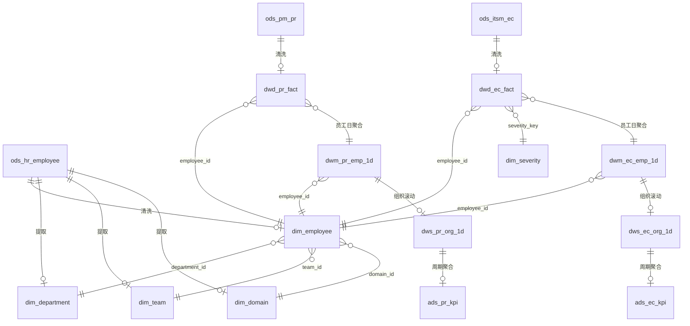

# 数据仓库数据库设计文档（全部分层）

本文档描述员工 KPI 数据仓库的完整分层设计，覆盖 **PR（项目需求）** 与 **EC（故障）** 两个业务方向，指标体系对齐《员工目录-KPI指标地图.md》。

## 1. 分层架构

| 层级 | 说明 | 表前缀 | 作用 |
|---|---|---|---|
| ODS 贴源层 | 保留业务系统原始数据 | `ods_` | 原始接入、去重暂存 |
| DWD 明细层 | 清洗、标准化、关联维度的事实明细 | `dwd_` | 统一口径、派生计算字段 |
| DIM 维度层 | 一致性维度 | `dim_` | 描述性属性 |
| DWM 中间层 | 主题级轻度汇总（通用复用） | `dwm_` | 员工×日原子汇总 |
| DWS 汇总层 | 按组织与粒度预聚合的业务汇总 | `dws_` | 多层级加速计算 |
| ADS 应用层 | 面向报表的 KPI 结果表 | `ads_` | 直接供报表使用 |

数据流向：

```text
业务系统 → ODS → DWD → DWM → DWS → ADS
              ↘ DIM ↗
```

## 2. 命名与通用规范

- 表名：`<层级前缀>_<主题>_<对象/粒度>`
- 字段：小写下划线
- 金额 `decimal(12,2)`，评分 `decimal(4,2)`，比率 `decimal(8,4)`（小数存储）
- 所有表 `utf8mb4`
- ODS 表统一附加 ETL 元数据列
- 事实表关联维度使用代理键（`*_key`），保留业务键（`*_id`）便于追溯

**ODS 通用 ETL 元数据列**：`etl_load_time`、`etl_source`、`etl_batch_id`、`etl_operation`、`data_date`

---

## 3. ODS 贴源层

### 3.1 ods_hr_employee（员工主数据）

| 字段 | 类型 | 说明 |
|---|---|---|
| employee_id | bigint | 员工 ID（业务主键） |
| employee_name | varchar(80) | 姓名 |
| department_id | bigint | 部门 ID |
| department_name | varchar(80) | 部门名称 |
| team_id | bigint | 团队 ID |
| team_name | varchar(80) | 团队名称 |
| domain_id | bigint | 领域 ID |
| domain_name | varchar(80) | 领域名称 |
| position | varchar(80) | 岗位 |
| job_level | varchar(32) | 职级 |
| employment_status | varchar(16) | 在职状态 |
| join_date | date | 入职日期 |
| manager_id | bigint | 直属上级 ID |
| + ETL 元数据列 | | |

### 3.2 ods_pm_pr（PR 项目需求）

| 字段 | 类型 | 说明 |
|---|---|---|
| pr_id | bigint | 需求 ID（业务主键） |
| pr_name | varchar(128) | 需求名称 |
| employee_id | bigint | 负责人 |
| project_id | bigint | 所属项目 ID |
| assign_date | date | 承接日期 |
| due_date | date | 计划交付日期 |
| complete_date | date | 实际完成日期 |
| status | varchar(16) | 状态 |
| rework_flag | tinyint | 是否返工 |
| work_hours | decimal(8,2) | 投入工时 |
| + ETL 元数据列 | | |

### 3.3 ods_itsm_ec（EC 故障）

| 字段 | 类型 | 说明 |
|---|---|---|
| ec_id | bigint | 故障 ID（业务主键） |
| ec_title | varchar(128) | 故障标题 |
| employee_id | bigint | 处理人 |
| project_id | bigint | 关联项目 ID |
| severity | varchar(8) | 等级（P0/P1/P2/P3） |
| found_at | datetime | 发现时间 |
| first_response_at | datetime | 首次响应时间 |
| resolved_at | datetime | 解决时间 |
| status | varchar(16) | 状态 |
| recur_flag | tinyint | 是否复发 |
| + ETL 元数据列 | | |

---

## 4. DWD 明细层

DWD 层职责：清洗脏数据、统一枚举、关联维度代理键、派生计算字段（时长、是否准时、是否严重）。

### 4.1 dwd_pr_fact（PR 需求明细事实）

来源：`ods_pm_pr`

| 字段 | 类型 | 说明 |
|---|---|---|
| pr_key | bigint | 代理键（主键） |
| pr_id | bigint | 业务键 |
| employee_id | bigint | 关联 dim_employee |
| assign_date_key | int | 承接日期键（dim_date） |
| due_date_key | int | 计划交付日期键 |
| complete_date_key | int | 完成日期键 |
| project_id | bigint | 项目 ID |
| status_code | varchar(16) | 标准化状态 |
| rework_flag | tinyint | 是否返工 |
| is_on_time | tinyint | 是否准时交付（1/0） |
| process_days | int | 处理时长（完成-承接，天） |
| work_hours | decimal(8,2) | 投入工时 |

### 4.2 dwd_ec_fact（EC 故障明细事实）

来源：`ods_itsm_ec`

| 字段 | 类型 | 说明 |
|---|---|---|
| ec_key | bigint | 代理键（主键） |
| ec_id | bigint | 业务键 |
| employee_id | bigint | 关联 dim_employee |
| project_id | bigint | 关联 dim_project |
| severity_key | tinyint | 关联 dim_severity |
| found_date_key | int | 发现日期键 |
| resolved_date_key | int | 解决日期键 |
| status_code | varchar(16) | 标准化状态 |
| recur_flag | tinyint | 是否复发 |
| is_severe | tinyint | 是否严重故障（P0/P1=1） |
| response_minutes | int | 首次响应时长（分钟） |
| resolve_minutes | int | 解决时长（分钟） |

---

## 5. DIM 维度层

### 5.1 dim_employee（员工维度）

| 字段 | 类型 | 说明 |
|---|---|---|
| employee_id | bigint | 员工 ID（主键，唯一标识） |
| employee_name | varchar(80) | 姓名 |
| department_id | bigint | 部门业务键 |
| team_id | bigint | 团队业务键 |
| domain_id | bigint | 领域业务键 |
| position_name | varchar(80) | 岗位名称 |
| job_level | varchar(32) | 职级 |
| employment_status | varchar(16) | 在职状态 |
| join_date | date | 入职日期 |
| manager_id | bigint | 直属上级 ID |

### 5.2 dim_department（部门维度）

| 字段 | 类型 | 说明 |
|---|---|---|
| department_key | bigint | 代理键（主键） |
| department_id | bigint | 业务键 |
| department_name | varchar(80) | 部门名称 |
| parent_department_id | bigint | 上级部门 |
| is_current | tinyint | 是否当前版本 |
| effective_date | date | 生效日期 |
| expire_date | date | 失效日期 |

### 5.3 dim_team（团队维度）

| 字段 | 类型 | 说明 |
|---|---|---|
| team_key | bigint | 代理键（主键） |
| team_id | bigint | 业务键 |
| team_name | varchar(80) | 团队名称 |
| department_id | bigint | 所属部门 |
| is_current | tinyint | 是否当前版本 |
| effective_date | date | 生效日期 |
| expire_date | date | 失效日期 |

### 5.4 dim_domain（领域维度）

| 字段 | 类型 | 说明 |
|---|---|---|
| domain_key | bigint | 代理键（主键） |
| domain_id | bigint | 业务键 |
| domain_name | varchar(80) | 领域名称 |
| is_current | tinyint | 是否当前版本 |
| effective_date | date | 生效日期 |
| expire_date | date | 失效日期 |

### 5.5 dim_date（日期维度）

| 字段 | 类型 | 说明 |
|---|---|---|
| date_key | int | 日期代理键（yyyymmdd） |
| full_date | date | 日期 |
| year | smallint | 年 |
| quarter | tinyint | 季度 |
| month | tinyint | 月 |
| week_of_year | tinyint | 年内周序 |
| day_of_week | tinyint | 周几 |
| is_weekend | tinyint | 是否周末 |
| is_holiday | tinyint | 是否节假日 |

### 5.6 dim_severity（故障等级维度）

| 字段 | 类型 | 说明 |
|---|---|---|
| severity_key | tinyint | 代理键（主键） |
| severity_code | varchar(8) | 等级编码 |
| severity_name | varchar(32) | 等级名称 |
| priority_order | tinyint | 排序权重 |

---

## 6. DWM 中间层

DWM 层基于 DWD 明细事实，按 **员工 × 日期** 做主题级轻度汇总，保留指标分子分母，供 DWS 层多组织、多周期复用。

### 6.1 dwm_pr_emp_1d（PR 员工日汇总）

| 字段 | 类型 | 说明 |
|---|---|---|
| stat_date | date | 统计日期 |
| employee_id | bigint | 员工 ID |
| pr_assign_cnt | int | 需求承接数 |
| pr_complete_cnt | int | 需求完成数 |
| pr_due_cnt | int | 应交付数 |
| pr_on_time_cnt | int | 准时交付数 |
| pr_rework_cnt | int | 返工数 |
| pr_process_days_sum | int | 处理时长总和（天） |
| pr_work_hours_sum | decimal(12,2) | 工时总和 |
| 主键 | | (stat_date, employee_id) |

### 6.2 dwm_ec_emp_1d（EC 员工日汇总）

| 字段 | 类型 | 说明 |
|---|---|---|
| stat_date | date | 统计日期 |
| employee_id | bigint | 员工 ID |
| ec_found_cnt | int | 故障发现数 |
| ec_resolved_cnt | int | 故障解决数 |
| ec_recur_cnt | int | 复发数 |
| ec_severe_cnt | int | 严重故障数 |
| ec_response_minutes_sum | int | 响应时长总和（分钟） |
| ec_resolve_minutes_sum | int | 解决时长总和（分钟） |
| 主键 | | (stat_date, employee_id) |

---

## 6A. DWS 汇总层

DWS 层从 DWM 层向上滚动，按 **组织 × 日期** 聚合。`org_type` 支持 employee / team / domain / department 四个层级。

### 6A.1 dws_pr_org_1d（PR 组织日汇总）

| 字段 | 类型 | 说明 |
|---|---|---|
| stat_date | date | 统计日期 |
| org_type | varchar(16) | 组织类型 |
| org_id | bigint | 组织业务键 |
| pr_assign_cnt | int | 需求承接数 |
| pr_complete_cnt | int | 需求完成数 |
| pr_due_cnt | int | 应交付数 |
| pr_on_time_cnt | int | 准时交付数 |
| pr_rework_cnt | int | 返工数 |
| pr_process_days_sum | int | 处理时长总和（天） |
| pr_work_hours_sum | decimal(12,2) | 工时总和 |
| 主键 | | (stat_date, org_type, org_id) |

### 6A.2 dws_ec_org_1d（EC 组织日汇总）

| 字段 | 类型 | 说明 |
|---|---|---|
| stat_date | date | 统计日期 |
| org_type | varchar(16) | 组织类型 |
| org_id | bigint | 组织业务键 |
| ec_found_cnt | int | 故障发现数 |
| ec_resolved_cnt | int | 故障解决数 |
| ec_recur_cnt | int | 复发数 |
| ec_severe_cnt | int | 严重故障数 |
| ec_response_minutes_sum | int | 响应时长总和（分钟） |
| ec_resolve_minutes_sum | int | 解决时长总和（分钟） |
| 主键 | | (stat_date, org_type, org_id) |

---

## 7. ADS 应用层

ADS 层面向报表，按 **组织 × 周期** 输出最终 KPI 指标，数据来自 DWS 组织日汇总的周期聚合。`org_type` 支持 employee / team / domain / department；`period_type` 支持 week / month / quarter / halfyear / year。

### 7.1 ads_pr_kpi（PR 项目需求 KPI）

| 字段 | 类型 | 说明 |
|---|---|---|
| period_type | varchar(16) | 周期类型 |
| period_value | varchar(32) | 周期值（如 2026-11、2026-W46） |
| org_type | varchar(16) | 组织类型 |
| org_id | bigint | 组织业务键 |
| pr_assign_cnt | int | 需求承接数 |
| pr_complete_cnt | int | 需求完成数 |
| pr_due_cnt | int | 应交付数 |
| pr_on_time_cnt | int | 准时交付数 |
| pr_process_days_sum | int | 处理时长总和（天） |
| pr_rework_cnt | int | 返工数 |
| pr_completion_rate | decimal(8,4) | 需求完成率 |
| pr_on_time_rate | decimal(8,4) | 准时交付率 |
| pr_avg_process_days | decimal(8,2) | 平均处理时长（天） |
| pr_rework_rate | decimal(8,4) | 返工率 |
| pr_work_hours_ratio | decimal(8,4) | 需求工时占比 |
| 主键 | | (period_type, period_value, org_type, org_id) |

### 7.2 ads_ec_kpi（EC 故障 KPI）

| 字段 | 类型 | 说明 |
|---|---|---|
| period_type | varchar(16) | 周期类型 |
| period_value | varchar(32) | 周期值 |
| org_type | varchar(16) | 组织类型 |
| org_id | bigint | 组织业务键 |
| ec_found_cnt | int | 故障发现数 |
| ec_resolved_cnt | int | 故障解决数 |
| ec_response_minutes_sum | int | 响应时长总和（分钟） |
| ec_resolve_minutes_sum | int | 解决时长总和（分钟） |
| ec_recur_cnt | int | 复发数 |
| ec_resolution_rate | decimal(8,4) | 故障解决率 |
| ec_avg_response_minutes | decimal(8,2) | 平均响应时长（分钟） |
| ec_avg_resolve_minutes | decimal(8,2) | 平均解决时长（分钟） |
| ec_recur_rate | decimal(8,4) | 故障复发率 |
| ec_severe_cnt | int | 严重故障数 |
| 主键 | | (period_type, period_value, org_type, org_id) |

---

## 8. KPI 指标与分层字段映射

### PR（项目需求）

| KPI 指标 | 计算口径 | 来源层与字段 |
|---|---|---|
| 需求承接数 | COUNT / SUM | dwm_pr_emp_1d.pr_assign_cnt |
| 需求完成数 | COUNT / SUM | dwm_pr_emp_1d.pr_complete_cnt |
| 需求完成率 | 完成数 ÷ 承接数 | ads_pr_kpi.pr_completion_rate |
| 准时交付率 | 准时数 ÷ 应交付数 | ads_pr_kpi.pr_on_time_rate |
| 平均处理时长 | 处理时长总和 ÷ 完成数 | ads_pr_kpi.pr_avg_process_days |
| 返工率 | 返工数 ÷ 已交付数 | ads_pr_kpi.pr_rework_rate |
| 需求工时占比 | 需求工时 ÷ 有效工时 | ads_pr_kpi.pr_work_hours_ratio |

### EC（故障）

| KPI 指标 | 计算口径 | 来源层与字段 |
|---|---|---|
| 故障发现数 | COUNT / SUM | dwm_ec_emp_1d.ec_found_cnt |
| 故障解决数 | COUNT / SUM | dwm_ec_emp_1d.ec_resolved_cnt |
| 故障解决率 | 解决数 ÷ 发现数 | ads_ec_kpi.ec_resolution_rate |
| 平均响应时长 | 响应时长总和 ÷ 故障数 | ads_ec_kpi.ec_avg_response_minutes |
| 平均解决时长 | 解决时长总和 ÷ 解决数 | ads_ec_kpi.ec_avg_resolve_minutes |
| 故障复发率 | 复发数 ÷ 已解决数 | ads_ec_kpi.ec_recur_rate |
| 严重故障数 | COUNT | ads_ec_kpi.ec_severe_cnt |

> 需求工时占比中的「有效工时」需接入考勤/工时系统，若不接入则 `pr_work_hours_ratio` 置空。

---

## 9. 表关系



---

## 10. 建表 SQL（MySQL 5.7，utf8mb4）

### 10.1 ODS 层

```sql
CREATE DATABASE IF NOT EXISTS analytics_dw
  CHARACTER SET utf8mb4 COLLATE utf8mb4_unicode_ci;
USE analytics_dw;

CREATE TABLE ods_hr_employee (
  employee_id       BIGINT       NOT NULL,
  employee_name     VARCHAR(80)  NOT NULL,
  department_id     BIGINT       NULL,
  department_name   VARCHAR(80)  NULL,
  team_id           BIGINT       NULL,
  team_name         VARCHAR(80)  NULL,
  domain_id         BIGINT       NULL,
  domain_name       VARCHAR(80)  NULL,
  position          VARCHAR(80)  NULL,
  job_level         VARCHAR(32)  NULL,
  employment_status VARCHAR(16)  NULL,
  join_date         DATE         NULL,
  manager_id        BIGINT       NULL,
  etl_load_time     DATETIME     NOT NULL,
  etl_source        VARCHAR(32)  NOT NULL,
  etl_batch_id      VARCHAR(64)  NULL,
  etl_operation     CHAR(1)      NOT NULL,
  data_date         DATE         NOT NULL,
  PRIMARY KEY (employee_id, data_date),
  KEY idx_data_date (data_date),
  KEY idx_department (department_id),
  KEY idx_team (team_id),
  KEY idx_domain (domain_id)
) ENGINE=InnoDB DEFAULT CHARSET=utf8mb4 COMMENT='员工主数据(ODS)';

CREATE TABLE ods_pm_pr (
  pr_id          BIGINT        NOT NULL,
  pr_name        VARCHAR(128)  NULL,
  employee_id    BIGINT        NULL,
  project_id     BIGINT        NULL,
  assign_date    DATE          NULL,
  due_date       DATE          NULL,
  complete_date  DATE          NULL,
  status         VARCHAR(16)   NULL,
  rework_flag    TINYINT       NULL,
  work_hours     DECIMAL(8,2)  NULL,
  etl_load_time  DATETIME      NOT NULL,
  etl_source     VARCHAR(32)   NOT NULL,
  etl_batch_id   VARCHAR(64)   NULL,
  etl_operation  CHAR(1)       NOT NULL,
  data_date      DATE          NOT NULL,
  PRIMARY KEY (pr_id, data_date),
  KEY idx_data_date (data_date),
  KEY idx_employee (employee_id),
  KEY idx_assign_date (assign_date)
) ENGINE=InnoDB DEFAULT CHARSET=utf8mb4 COMMENT='PR项目需求(ODS)';

CREATE TABLE ods_itsm_ec (
  ec_id             BIGINT        NOT NULL,
  ec_title          VARCHAR(128)  NULL,
  employee_id       BIGINT        NULL,
  project_id        BIGINT        NULL,
  severity          VARCHAR(8)    NULL,
  found_at          DATETIME      NULL,
  first_response_at DATETIME      NULL,
  resolved_at       DATETIME      NULL,
  status            VARCHAR(16)   NULL,
  recur_flag        TINYINT       NULL,
  etl_load_time     DATETIME      NOT NULL,
  etl_source        VARCHAR(32)   NOT NULL,
  etl_batch_id      VARCHAR(64)   NULL,
  etl_operation     CHAR(1)       NOT NULL,
  data_date         DATE          NOT NULL,
  PRIMARY KEY (ec_id, data_date),
  KEY idx_data_date (data_date),
  KEY idx_employee (employee_id),
  KEY idx_project (project_id),
  KEY idx_severity (severity)
) ENGINE=InnoDB DEFAULT CHARSET=utf8mb4 COMMENT='EC故障(ODS)';
```

### 10.2 DWD 层

```sql
CREATE TABLE dwd_pr_fact (
  pr_key          BIGINT        NOT NULL AUTO_INCREMENT,
  pr_id           BIGINT        NOT NULL,
  employee_id     BIGINT        NULL,
  assign_date_key INT           NULL,
  due_date_key    INT           NULL,
  complete_date_key INT         NULL,
  project_id      BIGINT        NULL,
  status_code     VARCHAR(16)   NULL,
  rework_flag     TINYINT       NULL,
  is_on_time      TINYINT       NULL,
  process_days    INT           NULL,
  work_hours      DECIMAL(8,2)  NULL,
  PRIMARY KEY (pr_key),
  KEY idx_pr_id (pr_id),
  KEY idx_employee (employee_id),
  KEY idx_assign_date (assign_date_key)
) ENGINE=InnoDB DEFAULT CHARSET=utf8mb4 COMMENT='PR需求明细事实(DWD)';

CREATE TABLE dwd_ec_fact (
  ec_key            BIGINT      NOT NULL AUTO_INCREMENT,
  ec_id             BIGINT      NOT NULL,
  employee_id       BIGINT      NULL,
  project_id        BIGINT      NULL,
  severity_key      TINYINT     NULL,
  found_date_key    INT         NULL,
  resolved_date_key INT         NULL,
  status_code       VARCHAR(16) NULL,
  recur_flag        TINYINT     NULL,
  is_severe         TINYINT     NULL,
  response_minutes  INT         NULL,
  resolve_minutes   INT         NULL,
  PRIMARY KEY (ec_key),
  KEY idx_ec_id (ec_id),
  KEY idx_employee (employee_id),
  KEY idx_project (project_id),
  KEY idx_severity (severity_key)
) ENGINE=InnoDB DEFAULT CHARSET=utf8mb4 COMMENT='EC故障明细事实(DWD)';
```

### 10.3 DIM 层

```sql
CREATE TABLE dim_employee (
  employee_id       BIGINT       NOT NULL,
  employee_name     VARCHAR(80)  NOT NULL,
  department_id     BIGINT       NULL,
  team_id           BIGINT       NULL,
  domain_id         BIGINT       NULL,
  position_name     VARCHAR(80)  NULL,
  job_level         VARCHAR(32)  NULL,
  employment_status VARCHAR(16)  NULL,
  join_date         DATE         NULL,
  manager_id        BIGINT       NULL,
  PRIMARY KEY (employee_id)
) ENGINE=InnoDB DEFAULT CHARSET=utf8mb4 COMMENT='员工维度(每日全量快照)';

CREATE TABLE dim_department (
  department_key       BIGINT      NOT NULL AUTO_INCREMENT,
  department_id        BIGINT      NOT NULL,
  department_name      VARCHAR(80) NOT NULL,
  parent_department_id BIGINT      NULL,
  is_current           TINYINT     NOT NULL DEFAULT 1,
  effective_date       DATE        NOT NULL,
  expire_date          DATE        NOT NULL DEFAULT '9999-12-31',
  PRIMARY KEY (department_key),
  KEY idx_department_id (department_id)
) ENGINE=InnoDB DEFAULT CHARSET=utf8mb4 COMMENT='部门维度';

CREATE TABLE dim_team (
  team_key       BIGINT      NOT NULL AUTO_INCREMENT,
  team_id        BIGINT      NOT NULL,
  team_name      VARCHAR(80) NOT NULL,
  department_id  BIGINT      NULL,
  is_current     TINYINT     NOT NULL DEFAULT 1,
  effective_date DATE        NOT NULL,
  expire_date    DATE        NOT NULL DEFAULT '9999-12-31',
  PRIMARY KEY (team_key),
  KEY idx_team_id (team_id)
) ENGINE=InnoDB DEFAULT CHARSET=utf8mb4 COMMENT='团队维度';

CREATE TABLE dim_domain (
  domain_key     BIGINT      NOT NULL AUTO_INCREMENT,
  domain_id      BIGINT      NOT NULL,
  domain_name    VARCHAR(80) NOT NULL,
  is_current     TINYINT     NOT NULL DEFAULT 1,
  effective_date DATE        NOT NULL,
  expire_date    DATE        NOT NULL DEFAULT '9999-12-31',
  PRIMARY KEY (domain_key),
  KEY idx_domain_id (domain_id)
) ENGINE=InnoDB DEFAULT CHARSET=utf8mb4 COMMENT='领域维度';

CREATE TABLE dim_date (
  date_key      INT       NOT NULL,
  full_date     DATE      NOT NULL,
  year          SMALLINT  NOT NULL,
  quarter       TINYINT   NOT NULL,
  month         TINYINT   NOT NULL,
  week_of_year  TINYINT   NOT NULL,
  day_of_week   TINYINT   NOT NULL,
  is_weekend    TINYINT   NOT NULL,
  is_holiday    TINYINT   NOT NULL,
  PRIMARY KEY (date_key)
) ENGINE=InnoDB DEFAULT CHARSET=utf8mb4 COMMENT='日期维度';

CREATE TABLE dim_severity (
  severity_key   TINYINT     NOT NULL,
  severity_code  VARCHAR(8)  NOT NULL,
  severity_name  VARCHAR(32) NOT NULL,
  priority_order TINYINT     NOT NULL,
  PRIMARY KEY (severity_key)
) ENGINE=InnoDB DEFAULT CHARSET=utf8mb4 COMMENT='故障等级维度';
```

### 10.4 DWM 层

```sql
CREATE TABLE dwm_pr_emp_1d (
  stat_date           DATE          NOT NULL,
  employee_id         BIGINT        NOT NULL,
  pr_assign_cnt       INT           NOT NULL DEFAULT 0,
  pr_complete_cnt     INT           NOT NULL DEFAULT 0,
  pr_due_cnt          INT           NOT NULL DEFAULT 0,
  pr_on_time_cnt      INT           NOT NULL DEFAULT 0,
  pr_rework_cnt       INT           NOT NULL DEFAULT 0,
  pr_process_days_sum INT           NOT NULL DEFAULT 0,
  pr_work_hours_sum   DECIMAL(12,2) NOT NULL DEFAULT 0,
  PRIMARY KEY (stat_date, employee_id),
  KEY idx_employee (employee_id)
) ENGINE=InnoDB DEFAULT CHARSET=utf8mb4 COMMENT='PR员工日汇总(DWM)';

CREATE TABLE dwm_ec_emp_1d (
  stat_date               DATE   NOT NULL,
  employee_id             BIGINT NOT NULL,
  ec_found_cnt            INT    NOT NULL DEFAULT 0,
  ec_resolved_cnt         INT    NOT NULL DEFAULT 0,
  ec_recur_cnt            INT    NOT NULL DEFAULT 0,
  ec_severe_cnt           INT    NOT NULL DEFAULT 0,
  ec_response_minutes_sum INT    NOT NULL DEFAULT 0,
  ec_resolve_minutes_sum  INT    NOT NULL DEFAULT 0,
  PRIMARY KEY (stat_date, employee_id),
  KEY idx_employee (employee_id)
) ENGINE=InnoDB DEFAULT CHARSET=utf8mb4 COMMENT='EC员工日汇总(DWM)';
```

### 10.4A DWS 层

```sql
CREATE TABLE dws_pr_org_1d (
  stat_date           DATE          NOT NULL,
  org_type            VARCHAR(16)   NOT NULL,
  org_id              BIGINT        NOT NULL,
  pr_assign_cnt       INT           NOT NULL DEFAULT 0,
  pr_complete_cnt     INT           NOT NULL DEFAULT 0,
  pr_due_cnt          INT           NOT NULL DEFAULT 0,
  pr_on_time_cnt      INT           NOT NULL DEFAULT 0,
  pr_rework_cnt       INT           NOT NULL DEFAULT 0,
  pr_process_days_sum INT           NOT NULL DEFAULT 0,
  pr_work_hours_sum   DECIMAL(12,2) NOT NULL DEFAULT 0,
  PRIMARY KEY (stat_date, org_type, org_id),
  KEY idx_org (org_type, org_id)
) ENGINE=InnoDB DEFAULT CHARSET=utf8mb4 COMMENT='PR组织日汇总(DWS)';

CREATE TABLE dws_ec_org_1d (
  stat_date               DATE        NOT NULL,
  org_type                VARCHAR(16) NOT NULL,
  org_id                  BIGINT      NOT NULL,
  ec_found_cnt            INT         NOT NULL DEFAULT 0,
  ec_resolved_cnt         INT         NOT NULL DEFAULT 0,
  ec_recur_cnt            INT         NOT NULL DEFAULT 0,
  ec_severe_cnt           INT         NOT NULL DEFAULT 0,
  ec_response_minutes_sum INT         NOT NULL DEFAULT 0,
  ec_resolve_minutes_sum  INT         NOT NULL DEFAULT 0,
  PRIMARY KEY (stat_date, org_type, org_id),
  KEY idx_org (org_type, org_id)
) ENGINE=InnoDB DEFAULT CHARSET=utf8mb4 COMMENT='EC组织日汇总(DWS)';
```

### 10.5 ADS 层

```sql
CREATE TABLE ads_pr_kpi (
  period_type         VARCHAR(16)   NOT NULL,
  period_value        VARCHAR(32)   NOT NULL,
  org_type            VARCHAR(16)   NOT NULL,
  org_id              BIGINT        NOT NULL,
  pr_assign_cnt       INT           NOT NULL DEFAULT 0,
  pr_complete_cnt     INT           NOT NULL DEFAULT 0,
  pr_due_cnt          INT           NOT NULL DEFAULT 0,
  pr_on_time_cnt      INT           NOT NULL DEFAULT 0,
  pr_process_days_sum INT           NOT NULL DEFAULT 0,
  pr_rework_cnt       INT           NOT NULL DEFAULT 0,
  pr_completion_rate  DECIMAL(8,4)  NULL,
  pr_on_time_rate     DECIMAL(8,4)  NULL,
  pr_avg_process_days DECIMAL(8,2)  NULL,
  pr_rework_rate      DECIMAL(8,4)  NULL,
  pr_work_hours_ratio DECIMAL(8,4)  NULL,
  PRIMARY KEY (period_type, period_value, org_type, org_id),
  KEY idx_org (org_type, org_id)
) ENGINE=InnoDB DEFAULT CHARSET=utf8mb4 COMMENT='PR项目需求KPI(ADS)';

CREATE TABLE ads_ec_kpi (
  period_type             VARCHAR(16)   NOT NULL,
  period_value            VARCHAR(32)   NOT NULL,
  org_type                VARCHAR(16)   NOT NULL,
  org_id                  BIGINT        NOT NULL,
  ec_found_cnt            INT           NOT NULL DEFAULT 0,
  ec_resolved_cnt         INT           NOT NULL DEFAULT 0,
  ec_response_minutes_sum INT           NOT NULL DEFAULT 0,
  ec_resolve_minutes_sum  INT           NOT NULL DEFAULT 0,
  ec_recur_cnt            INT           NOT NULL DEFAULT 0,
  ec_resolution_rate      DECIMAL(8,4)  NULL,
  ec_avg_response_minutes DECIMAL(8,2)  NULL,
  ec_avg_resolve_minutes  DECIMAL(8,2)  NULL,
  ec_recur_rate           DECIMAL(8,4)  NULL,
  ec_severe_cnt           INT           NOT NULL DEFAULT 0,
  PRIMARY KEY (period_type, period_value, org_type, org_id),
  KEY idx_org (org_type, org_id)
) ENGINE=InnoDB DEFAULT CHARSET=utf8mb4 COMMENT='EC故障KPI(ADS)';
```

---

## 11. 加载与更新策略

| 层级 | 表 | 方式 | 频率 |
|---|---|---|---|
| ODS | 全部 | 全量/增量（见各表说明） | 每日 |
| DWD | dwd_pr_fact / dwd_ec_fact | 增量清洗 + 关联维度代理键 | 每日 |
| DIM | 员工 | 每日全量快照（业务键即主键，不保留历史版本） | 每日 |
| DIM | 部门 / 团队 / 领域 | SCD Type 2（代理键 + `is_current` + 生效/失效区间） | 每日 |
| DIM | 日期 | 一次性预生成 | 年度 |
| DIM | 故障等级 | 手动维护 | 按需 |
| DWM | dwm_pr_emp_1d / dwm_ec_emp_1d | 从 DWD 按员工×日聚合 | 每日 |
| DWS | dws_pr_org_1d / dws_ec_org_1d | 从 DWM 按组织×日滚动 | 每日 |
| ADS | ads_pr_kpi / ads_ec_kpi | 从 DWS 按组织 × 周期聚合 | 每日（或 T+1） |

**ADS 周期聚合规则**

- `period_type=week`：按 ISO 周（dim_date.week_of_year）聚合
- `period_type=month`：按 `dim_date.month` 聚合
- `period_type=quarter`：按 `dim_date.quarter` 聚合
- `period_type=halfyear`：按半年（1-6 月 / 7-12 月）聚合
- `period_type=year`：按 `dim_date.year` 聚合
- `org_type` 从员工维度向上滚动：employee → team → domain → department

**比率指标在 ADS 层计算**，基于 DWM/DWS 汇总后的分子分母，避免逐行比率直接求和造成口径失真。
